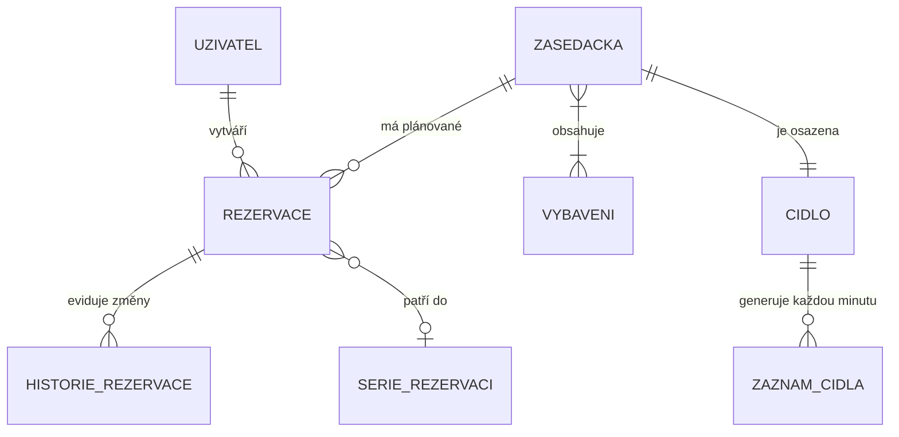

# Návrh aplikace: Rezervační systém zasedacích místností (Brixa)

Tento dokument představuje ucelený analytický návrh aplikace na základě zadání klientky Kláry Benešové a následně vyjasněných provozních pravidel. Dokument slouží jako závazný podklad pro realizaci.

---

## 1. Entity a vazby mezi nimi

Systém eviduje zasedací místnosti, uživatele s definovanými rolemi, rezervace (včetně týdenních sérií), telemetrii z IoT čidel a kompletní auditní historii.

### Přehled entit a atributů:
- **Zasedacka (Zasedací místnost)**
  - `id`: unikátní identifikátor
  - `nazev`: název místnosti (celkem 6 místností od „budky“ po místnost pro 20 lidí)
  - `patro`: patro budovy
  - `kapacita`: kapacita (2 až 20 osob)
  - `vybaveni`: přiřazené vybavení (M:N)
- **Vybaveni (Katalog vybavení)**
  - `id`: identifikátor
  - `nazev`: projektor, obrazovka, tabule
- **Uzivatel (Zaměstnanec)**
  - `id`: identifikátor
  - `jmeno`: jméno a příjmení
  - `email`: e-mail pro přihlášení a doručování notifikací
  - `role`: 
    - `Zaměstnanec`: správa vlastních rezervací
    - `Asistentka`: možnost rušit i cizí rezervace s povinným odůvodněním
    - `Reditel`: přístup k manažerským statistikám využití a blokování
    - `OfficeManager` (Klára): plná správa místností, čidel a auditní stopy
- **Rezervace**
  - `id`: identifikátor
  - `zasedacka_id`: reference na místnost
  - `uzivatel_id`: organizátor rezervace
  - `serie_id`: volitelná reference na opakovanou sérii
  - `cas_od`, `cas_do`: časový interval
  - `ucel`: předmět jednání
  - `cas_vytvoreni`: systémové razítko vzniku (automatické, nezadává se ručně)
  - `stav`: `Aktivní`, `Probíhající`, `Dokončená`, `Zrušená uživatelem`, `Uvolněná systémem (nepřítomnost)`
  - *Zásada:* Žádná rezervace se z databáze fyzicky nemaže.
- **SerieRezervaci**
  - `id`: identifikátor série
  - `perioda`: týdenní opakování
  - `datum_konec`: datum ukončení opakování
- **HistorieRezervace (Auditní záznam)**
  - `id`: identifikátor změny
  - `rezervace_id`: reference na rezervaci
  - `cas_zmeny`: časové razítko úkonu
  - `puvodni_stav`, `novy_stav`: přechod stavu
  - `provedl_uzivatel_id`: konkrétní uživatel, asistentka nebo systém
  - `duvod`: povinný důvod při zrušení cizí rezervace asistentkou nebo automatické hlášení systému
- **Cidlo (IoT jednotka v místnosti)**
  - `id`: identifikátor čidla
  - `zasedacka_id`: vazba 1:1 na místnost
  - `stav`: `Online` / `Offline`
  - `posledni_odezva`: čas posledního paketu
- **ZaznamCidla (Telemetrie 1× za minutu)**
  - `id`: identifikátor záznamu
  - `cidlo_id`: reference na čidlo
  - `cas_mereni`: čas odečtu
  - `pritomnost`: boolean (detekce přítomnosti osob bez nutnosti tabletů)
  - `pocet_osob`: orientační počet lidí v místnosti
  - `co2_ppm`: koncentrace CO2 v ppm

---

## 2. Obrazovky a co na nich uživatel udělá

1. **Přehled dne (Dashboard v reálném čase)**
   - *Co vidí:* Karty všech 6 zasedaček, stav (volná / obsazená / kdy se uvolní), živá data z čidel (přítomnost, počet lidí, CO2 s barevným varováním při > 1000 ppm), stav spojení s čidlem (online/offline).
   - *Co udělá:* Rychlá rezervace ihned volné místnosti, přechod na detail zasedačky nebo vyhledávání.

2. **Vyhledání a vytvoření rezervace**
   - *Co vidí:* Formulář filtrů (datum, čas od–do, počet osob, patro, vybavení: projektor/obrazovka/tabule, přepínač „opakovat týdně“), seznam vyhovujících místností.
   - *Co udělá:* Zadá parametry, vybere místnost, vyplní účel. U týdenních rezervací systém zkontroluje kolize: pokud některý budoucí termín koliduje, upozorní uživatele a umožní mu vybrat jiný čas/místnost nebo daný den vynechat. Rezervace se nesmí překrývat ani o minutu.

3. **Můj kalendář a správa rezervací**
   - *Co vidí:* Harmonogram vlastních schůzek (i proběhlých či uvolněných).
   - *Co udělá:* Uživatel může zrušit vlastní rezervaci. Asistentka ředitele zde může zrušit i cizí rezervaci po povinném vyplnění důvodu zrušení.

4. **Správa místností a čidel (Administrace – Klára)**
   - *Co vidí:* Seznam zasedaček (parametry, kapacita, vybavení), stav spárovaných čidel (čas posledního hlášení, online/offline).
   - *Co udělá:* Editace parametrů místností, diagnostika čidel (při výpadku zůstávají rezervace zachovány, Klára vidí varovný stav).

5. **Statistiky a reporting využití (Ředitel, Klára)**
   - *Co vidí:* Měsíční vytíženost místností, přehled zrušených schůzek a jmenný přehled zaměstnanců, kteří nejvíce blokovali místnosti (propadlé rezervace „duchů“).
   - *Co udělá:* Ředitel a Klára generují měsíční reporty pro optimalizaci využití prostor.

---

## 3. Chytrá pravidla (Událost – Podmínka – Akce)

- **Pravidlo 1: Uvolnění místnosti při neúčasti („Lov duchů“)**
  - **Událost:** Uplynutí 15 minut od plánovaného začátku rezervace.
  - **Podmínka:** Rezervace je ve stavu `Aktivní` A čidlo v místnosti hlásí `pritomnost == false` nepřetržitě po celých 15 minut.
  - **Akce:** Změnit stav rezervace na `Uvolněná systémem (nepřítomnost)`, zaznamenat do `HistorieRezervace`, místnost okamžitě označit jako volnou a odeslat e-mailové upozornění organizátorovi rezervace.

- **Pravidlo 2: Varování před vydýchaným vzduchem (vysoké CO2)**
  - **Událost:** Přijetí minutového odečtu z čidla.
  - **Podmínka:** Naměřená hodnota `co2_ppm > 1000` A čidlo hlásí `pritomnost == true`.
  - **Akce:** Zobrazit na dashboardu místnosti výrazné vizuální upozornění na překročení limitu CO2 s doporučením vyvětrat.

- **Pravidlo 3: Validace kolizí a striktní zákaz překryvu**
  - **Událost:** Pokus o vytvoření či úpravu rezervace (jednorázové i týdenní).
  - **Podmínka:** Existuje časový překryv (i o 1 minutu) s jinou platnou rezervací stejné místnosti.
  - **Akce:** Rezervaci zamítnout, zobrazit kolidující čas a uživatele vyzvat k úpravě termínu či volbě jiné místnosti.

- **Pravidlo 4: Detekce výpadku telemetrie čidla**
  - **Událost:** Minutová kontrola komunikace s čidly.
  - **Podmínka:** Od čidla nedorazil žádný paket po dobu delší než 5 minut.
  - **Akce:** Nastavit stav čidla na `Offline`, zobrazit varovný příznak na dashboardu administrace. Rezervace pro tuto místnost zůstávají platné a neruší se.

---

## 4. Vyjasněná provozní pravidla a rozhodnutí klienta

Na základě doplňujících odpovědí klientky byla do návrhu zapracována tato konkrétní rozhodnutí:

1. **Časový limit pro neúčast:** Stanoven na přesně **15 minut** od začátku rezervace.
2. **Vyhodnocení přítomnosti:** Běží **čistě automaticky přes stropní/prostorová čidla**; tablety se neinstalují.
3. **Notifikace organizátorovi:** Při automatickém uvolnění místnosti systém odešle organizátorovi **e-mailové oznámení**.
4. **Uživatelské role:** Rozlišují se 4 role: Běžný zaměstnanec, Asistentka ředitele, Ředitel a Office manažerka (Klára).
5. **Rušení cizích rezervací:** Asistentky ředitele smí zrušit cizí rezervaci výhradně se **zadáním povinného důvodu**, který se zapíše do auditní stopy.
6. **Výpadek čidla:** Při výpadku telemetrie zůstávají **naplánované rezervace platné** (žádná rezervace se kvůli poruše čidla automaticky neruší).
7. **Statistika blokování:** Měsíční statistika pro ředitele zachová **jmenný přehled osob**, které místnosti blokovaly bez využití.
8. **Integrace s MS Teams:** Ponechána jako **budoucí rozšíření** po nasazení MVP.
9. **Budoucí rozsah Teams notifikací:** Počítá se s osobními zprávami (připomenutí schůzky 10 min předem, zpráva o uvolnění, varování o CO2).
10. **Opakované porady:** Systém podporuje **týdenní opakování** rezervací s definovaným koncem série.
11. **Kolize u sérií:** Při detekci konfliktu systém uživatele **upozorní a umožní manuální úpravu** či vynechání kolizního termínu.
12. **Upozornění na CO2:** Spouští se při překročení **1000 ppm** formou **vizuálního upozornění** na obrazovce přehledu.
13. **Přihlašování:** Využije se firemní přihlašování (e-mail + bezpečné ověření s připraveností na Microsoft 365 SSO).
